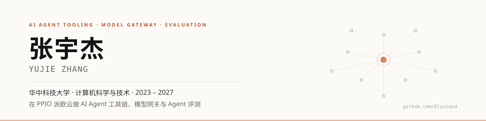
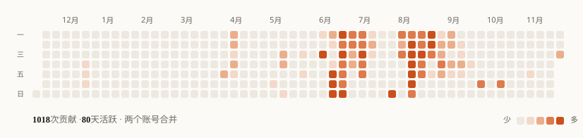

<picture>
  <source media="(prefers-color-scheme: dark)" srcset="./assets/hero-dark.svg">
  
</picture>

<picture>
  <source media="(prefers-color-scheme: dark)" srcset="./assets/typing-dark.svg">
  
</picture>

## 主线项目

<table>
<tr>
<td width="50%" valign="top">

### [BootAgent](https://github.com/MaimoryLab/BootAgent) &nbsp; 

本地 AI 编程 Agent 工作台。检测、安装、配置 10 种编程 Agent 与 5 个内置模型服务。

`Go` `Wails v3` `React`

**发起人 / 核心开发** — 443 次提交中的 239 次（53%）

</td>
<td width="50%" valign="top">

### [AI-Inbox](https://github.com/MaimoryLab/AI-Inbox) &nbsp; 

扫描 Codex、Claude Code、Cursor 的本地会话，抽取待办卡片并绑定原文证据。

`TypeScript` `React` `MCP`

</td>
</tr>
<tr>
<td valign="top">

### [MoM](https://github.com/MaimoryLab/MoM) &nbsp; 

Mixture-of-Models 网关：fan-out 廉价 advisor 后聚合结果。

`TypeScript`

</td>
<td valign="top">

### [codeoff](https://github.com/MaimoryLab/codeoff) &nbsp; 

远程控制本机 Codex 会话。

`Dart` `Go`

</td>
</tr>
</table>

## 个人项目

| 项目 | 说明 | 栈 |
| :--- | :--- | :--- |
| [**intent-translator**](https://github.com/Elysiasd/intent-translator) | 自然语言数据需求 → 结构化元数据查询。语用访问的最小原型，含冻结数据集与回归评测 | Python |
| [**imagenet-translator**](https://github.com/Elysiasd/imagenet-translator) | 自然语言图像检索请求 → Milvus 查询 | Python |
| [**NiuLai**](https://github.com/Elysiasd/NiuLai) | DeepSeek Harness 的水墨风主题插件，零依赖 | JavaScript |
| [**ThinkingA**](https://github.com/Elysiasd/ThinkingA) | 想法 → 开发 Plan → 本地 AI CLI Prompt | TypeScript |
| [**AI-Infra-Learning**](https://github.com/Elysiasd/AI-Infra-Learning) | 存储方向 AI Infra 的学习路线与实验 | Python |

## 技术栈

**语言** 

**大模型与应用** 

**工程** 

## 近一年

<picture>
  <source media="(prefers-color-scheme: dark)" srcset="./assets/contrib-dark.svg">
  
</picture>

合并 [Elysiasd](https://github.com/Elysiasd) 与 [yujiezhang-ops](https://github.com/yujiezhang-ops) 两个账号，每日自动重建。

## 正在学习

面向大模型应用开发的八周计划：协议与流式 → 网关 → RAG → Agent → 评测 → 原理。

| 周 | 主题 | 产出 |
| :--- | :--- | :--- |
| 1 | LLM 接口与 SSE 流式 | 可用的客户端与流式解析 |
| 2 | 模型网关 | 多协议透传与用量计量 |
| 3 | RAG | 切块、检索、召回评估 |
| 4 | Agent 与 MCP | 结构化抽取与工具调用 |
| 5–6 | 工具链与评测 | 读懂既有项目、做迷你评测框架 |
| 7–8 | 原理与表达 | Transformer 基础、模拟面试 |

## 联系

华中科技大学 · 计算机科学与技术 · 2023 – 2027 · 在 PPIO 派欧云
